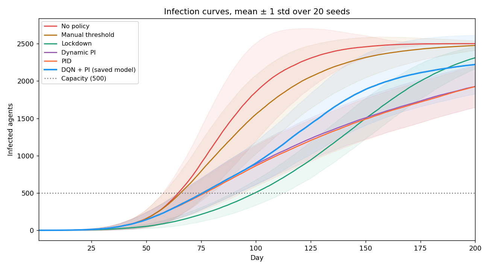
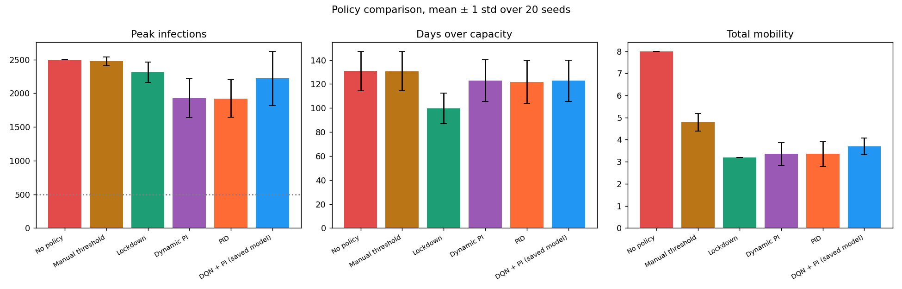
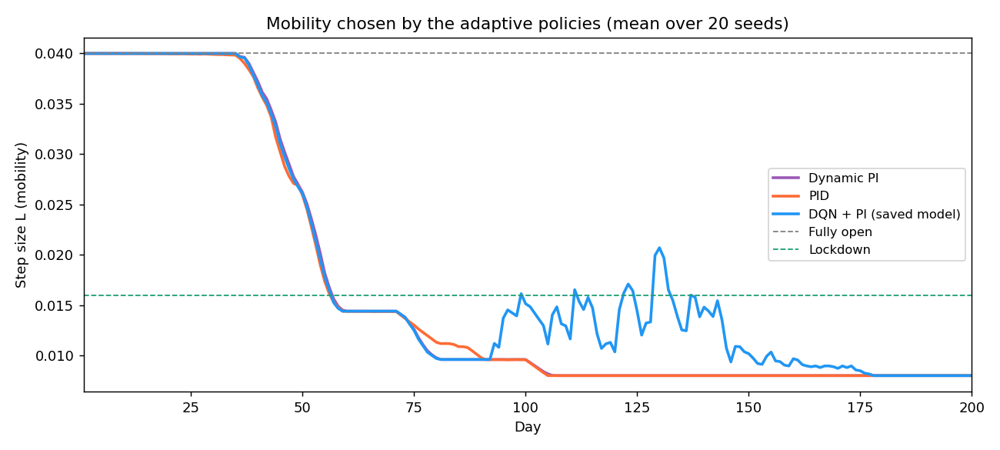
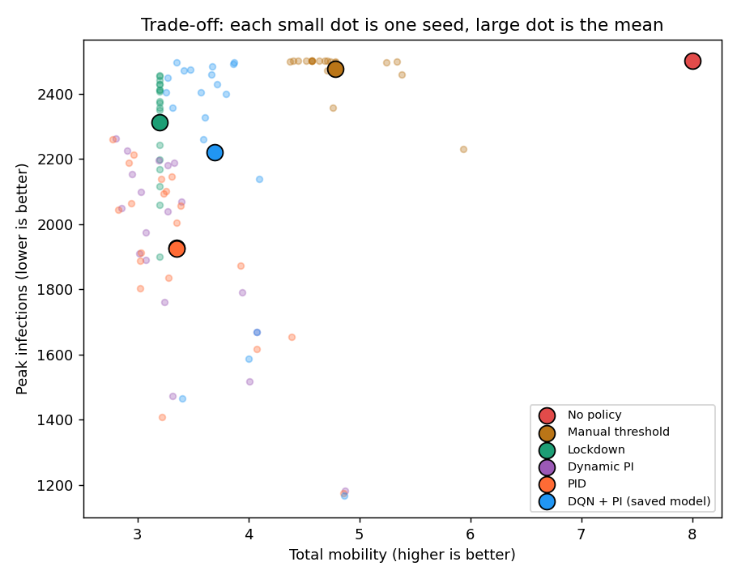
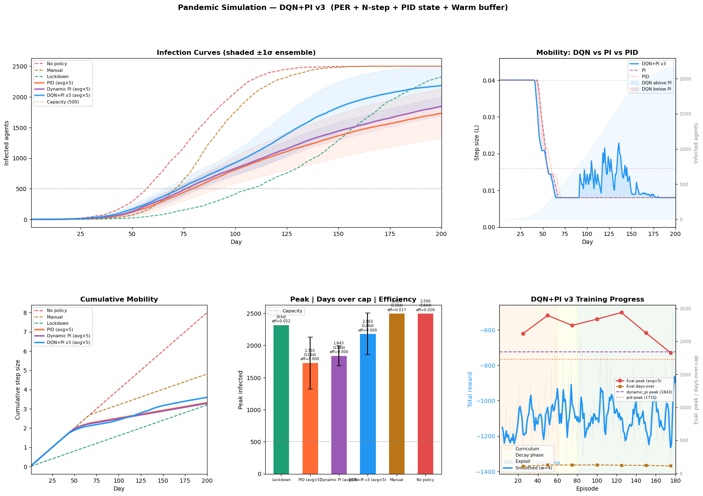

# Pandemic Mobility Control with PI, PID and Deep Q-Learning

An agent-based pandemic simulation in which a policy decides each day how freely people may move. The aim is to keep peak infections low (hospital capacity is 500 of 2,500 people) while allowing as much mobility as possible. Six policies are compared: no policy, a manual threshold, full lockdown, a dynamic PI controller, a PID controller, and a deep Q-network (DQN) that learns to adjust the PI controller's output.

## Coursework and context

Done for **Reinforcement Learning**, Semester 6 (Spring 2026), Plaksha University.

The course project was a group project. **This repository is not the final project our group presented.** It is an independent line of work I developed alongside the group project, to test whether a learned policy could improve on a classical controller for the same kind of control problem.

## How the simulation works

- 2,500 agents start at random positions in a unit square. One agent near the centre is infected.
- Each day every agent takes a step of length L in a random direction, reflecting off the walls. A susceptible agent becomes infected if it is within a small radius of an infected agent (a grid is used so only neighbouring cells are checked). There is no recovery, so the question is how fast and how high the curve rises.
- The policy sets L each day: L = 0.04 is fully open and L = 0.016 is lockdown.
- One episode is 200 days.

## Policies

| Policy | Rule |
|---|---|
| No policy | Always fully open |
| Manual threshold | Lockdown when more than 80% of capacity is infected, otherwise open |
| Lockdown | Always lockdown |
| Dynamic PI | Predicts the load from the current level plus the recent trend, then reduces mobility exponentially as it approaches capacity. An integral term tightens further while over capacity. It also has hysteresis and a rate limit |
| PID | The PI output plus a derivative correction, so it tightens earlier when infections accelerate |
| DQN + PI | A dueling double DQN chooses one of 10 blend weights that move the PI output towards lockdown or towards fully open. Its state has 10 features (load, trend, acceleration, the PI and PID suggestions, current mobility, day, susceptible fraction). Training uses prioritised replay, 10-step returns, a replay buffer pre-filled with 30 PI and 30 PID episodes, and a reward for mobility gated by load, with penalties for overload and acceleration |

## Results

`evaluate.py` runs every policy for 20 episodes. Episode *s* of every policy uses the same random seed, so all policies face the same initial populations. The DQN is the saved model `saved_models/dqn_pi_v3.pth`.

| Policy | Peak infections | Total mobility | Days over capacity |
|---|---|---|---|
| No policy | 2500 ± 1 | 8.00 | 131 ± 16 |
| Manual threshold | 2475 ± 66 | 4.79 ± 0.39 | 131 ± 16 |
| Lockdown | 2311 ± 151 | 3.20 | 100 ± 13 |
| Dynamic PI | 1927 ± 289 | 3.35 ± 0.51 | 123 ± 17 |
| PID | 1924 ± 281 | 3.35 ± 0.55 | 122 ± 18 |
| DQN + PI | 2221 ± 404 | 3.69 ± 0.38 | 123 ± 17 |

(mean ± standard deviation over 20 seeds)

What the results show:

- The PI and PID controllers give the lowest peaks: about 23% below no policy and about 17% below permanent lockdown, with slightly more mobility than lockdown.
- The DQN learned to allow about 10% more mobility than the PI controller (+0.34 on average, same seeds), but its peak is about 294 people higher. It beat PI on both measures in only 1 of 20 seeds. **The DQN did not outperform the classical controllers.** It moves along the trade-off curve towards more mobility rather than improving on it. The original notebook reached the same conclusion ("behind" against both PI and PID).
- No adaptive policy keeps infections under capacity for most of the 200 days. With no recovery in the model, every curve eventually rises, so peak and timing are the meaningful measures.



*Mean number of infected agents per day for each policy; the shaded band is ± 1 standard deviation over 20 seeds.*



*Peak infections, days over capacity and total mobility for each policy.*



*Average step size chosen each day by the three adaptive policies. Between about day 90 and day 150 the DQN partly relaxes restrictions, while PI and PID stay at their minimum.*



*Each small dot is one episode and each large dot is a policy's mean. The PI and PID means overlap.*

The figure produced by the original training run (the notebook output) is kept as well:



*Original notebook figure: infection curves, mobility, peak bars and DQN training progress over 180 episodes.*

## Files

| File | Contents |
|---|---|
| `pandemic_policy_rl.ipynb` | The original notebook with its saved outputs: the first PI version, DQN + PI v3 training, and saving and reloading the model |
| `pandemic_sim.py` | Simulation, PI and PID controllers, state vector and DQN network, taken from the notebook so they can be imported |
| `evaluate.py` | Evaluates the six policies on the same seeds and writes `results/` and the figures in `images/` |
| `saved_models/dqn_pi_v3.pth` | Trained DQN weights |
| `results/summary.csv`, `results/per_episode.csv` | The numbers behind the table above |

## How to run

```
pip install -r requirements.txt
python evaluate.py          # about 3 minutes on a CPU, uses the saved model
jupyter notebook pandemic_policy_rl.ipynb   # retrains the DQN, about 30 minutes
```

## Notes and limitations

- Efficiency in the notebook's ensemble rows printed as 0.0001 because it divided the per-day mobility array instead of its total. This is fixed in `pandemic_sim.py`. The notebook outputs are left as they were originally run.
- The notebook's last evaluation cell uses a 60% threshold for the manual policy. `evaluate.py` uses 80%, the same as the training baselines.
- The model has no recovery, no age groups and no spatial structure beyond the random walk. It is a testbed for comparing control strategies, not an epidemiological forecast.
- With 20 seeds the standard deviations are large (about ±300 on peak), so small differences between PI and PID are not meaningful.
